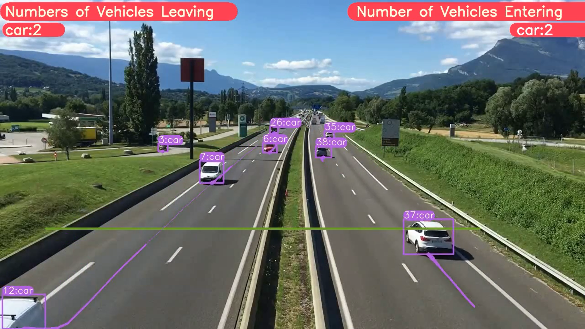

# YOLOv8 + DeepSORT Object Tracking

Detect objects in video, assign track IDs across frames, and visualize their motion with bounding boxes, class labels, and trajectory trails. This project combines a bundled **Ultralytics YOLOv8 8.0.3** detector with a custom **DeepSORT** tracking integration, and includes notebooks for pretrained inference and custom dataset training.



*Repository illustration: the image includes vehicle counters, but the current tracking script implements boxes, IDs, and trails only. Line-crossing counts are not implemented.*

## Contents

- [Features](#features)
- [Project structure](#project-structure)
- [Installation](#installation)
- [Run object tracking](#run-object-tracking)
- [Train on a custom dataset](#train-on-a-custom-dataset)
- [Notebooks](#notebooks)
- [Troubleshooting and limitations](#troubleshooting-and-limitations)
- [Credits and license](#credits-and-license)

## Features

- YOLOv8 object detection with pretrained or custom `.pt` weights.
- DeepSORT association of detections with track IDs across video frames.
- Class-colored boxes labeled with `track_id:class_name`.
- Motion trails storing up to 64 points per active track.
- Video file, webcam, and stream inputs through the bundled input loaders.
- Annotated video output and optional live display.
- Training and validation scripts for custom detection datasets.

The tracking flow is:

```text
Video frames -> YOLOv8 detections -> DeepSORT association -> IDs, boxes, and trails -> Annotated video
```

Track IDs describe tracks within a run; they are not permanent identities and may change after an object is lost.

## Project structure

```text
.
|-- figure/                            # Repository illustrations
|-- ultralytics/                       # Bundled YOLOv8 source (8.0.3)
|   |-- models/                        # Model architecture YAML files
|   `-- yolo/
|       |-- configs/default.yaml       # Detection, training, and output settings
|       `-- v8/detect/
|           |-- predict.py             # Custom YOLOv8 + DeepSORT integration
|           |-- train.py               # Detection training entry point
|           `-- val.py                 # Detection validation entry point
|-- YOLOv8_DeepSORT_TRACKING_SCRIPT.ipynb
|-- YOLOv8_Detection_Tracking_CustomData_Complete.ipynb
|-- requirements.txt
`-- setup.py
```

**The DeepSORT package, its re-identification checkpoint, YOLO weights, datasets, and input videos are not included in this checkout.** Set up the external tracking files before running the scripts.

## Installation

### 1. Create a Python environment

Open a terminal in the project root, where `setup.py` is located:

```sh
python -m venv .venv
```

Activate it on Windows PowerShell:

```powershell
.\.venv\Scripts\Activate.ps1
```

Or on Linux/macOS:

```sh
source .venv/bin/activate
```

The package declares Python `>=3.7`, but its dependencies have no upper version bounds and there is no locked environment. This is legacy code; compatibility with current Python and dependency releases has not been established.

### 2. Install the local package

Install a CUDA-enabled PyTorch and matching torchvision build suitable for your system, then install this checkout:

```sh
python -m pip install -e .
python -m pip install gdown
```

The editable install uses the bundled `ultralytics` code and installs the dependencies from [requirements.txt](requirements.txt). Keep this environment dedicated to the project: installing another Ultralytics release can change which implementation is imported.

Check whether PyTorch can access the GPU:

```sh
python -c "import torch; print('CUDA available:', torch.cuda.is_available())"
```

The tracker is initialized with `use_cuda=True` in `predict.py`. The supplied workflow therefore targets an NVIDIA GPU with CUDA-enabled PyTorch. Passing `device=cpu` only changes the detector setting; see the CPU note below.

### 3. Add DeepSORT and its checkpoint

The notebooks download a DeepSORT archive from Google Drive. Run the same download from the detection directory:

```sh
cd ultralytics/yolo/v8/detect
gdown "https://drive.google.com/uc?id=11ZSZcG-bcbueXZC3rN08CM0qqX3eiHxf" -O deep_sort_pytorch.zip
python -m zipfile -e deep_sort_pytorch.zip .
```

This is the external archive referenced by the included notebooks; its current availability and contents have not been verified. If the link is unavailable, obtain the compatible archive from the original project. The integration expects a DeepSORT implementation whose `update` method accepts bounding boxes, confidence scores, class IDs, and a frame, and returns track IDs alongside class IDs.

After extraction, confirm that the following paths exist:

```text
ultralytics/yolo/v8/detect/
|-- predict.py
`-- deep_sort_pytorch/
    |-- configs/deep_sort.yaml
    |-- deep_sort/
    `-- utils/
```

Install any additional dependencies declared by the downloaded DeepSORT package. Open `deep_sort_pytorch/configs/deep_sort.yaml` and verify that `DEEPSORT.REID_CKPT` points to an existing re-identification checkpoint. Extracting Python source alone is not sufficient if that checkpoint is missing.

**Run the commands below from `ultralytics/yolo/v8/detect/`.** The tracker configuration and checkpoint paths are resolved relative to the working directory.

## Run object tracking

Place an input video named `input.mp4` in the detection directory, or substitute an absolute path. Supply compatible YOLOv8 weights locally if automatic downloading is unavailable.

### Video file

```sh
python predict.py model=yolov8n.pt source="input.mp4" mode=predict save=True project="../../../../runs/detect" name=tracking
```

This writes the annotated video to `runs/detect/tracking/input.mp4` under the project root. Repeated runs receive incremented directory names, such as `tracking2`, unless `exist_ok=True` is set. The terminal prints the actual output directory.

### Webcam

```sh
python predict.py model=yolov8n.pt source=0 mode=predict show=True save=True project="../../../../runs/detect" name=webcam
```

`source=0` selects the first camera. Use another index if needed, and stop the process with `Ctrl+C`.

### Custom model

```sh
python predict.py model="../../../../runs/detect/custom_train/weights/best.pt" source="input.mp4" mode=predict save=True project="../../../../runs/detect" name=custom_tracking
```

### Useful options

Arguments use Hydra's `key=value` syntax. See [default.yaml](ultralytics/yolo/configs/default.yaml) for the full configuration; not every inherited option is implemented by the custom tracker.

| Option | Example | Purpose |
| --- | --- | --- |
| `model` | `model=yolov8n.pt` | Detector checkpoint; defaults to `yolov8n.pt` in the tracking entry point. |
| `source` | `source="input.mp4"` | Video path, camera index, or stream URL. |
| `conf` | `conf=0.35` | Detector confidence threshold; prediction defaults to `0.25`. |
| `iou` | `iou=0.7` | Non-maximum suppression IoU threshold. |
| `imgsz` | `imgsz=640` | Detector input size. |
| `device` | `device=0` | Detector device; DeepSORT has a separate CUDA setting. |
| `show` | `show=True` | Display annotated frames where a GUI is available. |
| `save` | `save=True` | Save annotated output. |
| `vid_stride` | `vid_stride=2` | Process every second frame; may reduce tracking continuity. |
| `project`, `name` | `project="../../../../runs/detect" name=demo` | Output parent directory and run name. |

DeepSORT association settings, including `MAX_DIST`, `MAX_AGE`, `N_INIT`, and `NN_BUDGET`, are read from its downloaded YAML configuration.

## Train on a custom dataset

Prepare a detection dataset with matching image and label filenames:

```text
dataset/
|-- images/
|   |-- train/
|   `-- val/
|-- labels/
|   |-- train/
|   `-- val/
`-- data.yaml
```

Each label row contains a zero-based class ID and normalized box coordinates:

```text
class_id x_center y_center width height
```

Example `data.yaml` (replace the path and class names):

```yaml
path: /absolute/path/to/dataset
train: images/train
val: images/val
names:
  0: person
  1: vehicle
```

On Windows, use a path such as `D:/datasets/my_dataset`.

From `ultralytics/yolo/v8/detect/`, train with:

```sh
python train.py model=yolov8n.pt data="/absolute/path/to/dataset/data.yaml" epochs=50 imgsz=640 project="../../../../runs/detect" name=custom_train
```

Validate the saved checkpoint:

```sh
python val.py model="../../../../runs/detect/custom_train/weights/best.pt" data="/absolute/path/to/dataset/data.yaml" mode=val
```

Use the actual training output directory if the run name was incremented. Pass its `weights/best.pt` file to `predict.py` to track your custom classes. This workflow trains the YOLO detector; it does not retrain DeepSORT's appearance model.

## Notebooks

| Notebook | Workflow |
| --- | --- |
| [YOLOv8 DeepSORT tracking](YOLOv8_DeepSORT_TRACKING_SCRIPT.ipynb) | Download tracking assets, process example videos, and display results. |
| [Custom dataset training and tracking](YOLOv8_Detection_Tracking_CustomData_Complete.ipynb) | Download a dataset through Roboflow, train and validate a detector, then run tracking. |

The notebooks assume a Google Colab environment with `/content/...` paths and Linux shell commands. Adjust paths and commands for local use. The custom dataset notebook also needs your own Roboflow credentials and dataset selection. Its video display cells use FFmpeg to create a browser-playable copy; FFmpeg is separate from the Python dependencies.

## Troubleshooting and limitations

| Problem | What to check |
| --- | --- |
| `No module named 'deep_sort_pytorch'` | Extract the compatible DeepSORT archive into `ultralytics/yolo/v8/detect/` and launch the script from that directory. |
| Missing `deep_sort.yaml` or re-identification checkpoint | Check the working directory and the `DEEPSORT.REID_CKPT` path in the downloaded configuration. |
| CUDA initialization failure | Check the NVIDIA driver and PyTorch CUDA support. The script explicitly requests CUDA for DeepSORT. |
| Missing dependencies after extracting DeepSORT | Install the dependencies required by that archive in the same virtual environment. |
| Import or checkpoint errors after dependency upgrades | Confirm that the local 8.0.3 package is imported and that weights and dependencies are compatible with this legacy code. No reproducible version lock is supplied. |
| No display window | Use a desktop session with OpenCV GUI support. For video files in headless environments, use `show=False save=True` and inspect the output file. |
| Output appears in an unexpected folder | Set `project` and `name` explicitly and check the path printed in the terminal. Without `mode=predict`, the inherited mode is `train`, even when running `predict.py`. |

Additional implementation details to keep in mind:

- **CPU execution:** inspect the downloaded DeepSORT implementation's CPU support and adjust `use_cuda=True` in `init_tracker()` if necessary, along with the detector's `device=cpu` setting. CPU operation has not been validated here.
- **One source per process:** the tracker and trajectory buffers are global. Separate processes are needed to isolate tracks across independent videos or cameras.
- **Missed detections:** frames with no detections return before updating DeepSORT, which can affect track aging during gaps.
- **Exports:** the custom `write_results()` does not implement track-ID text/CSV exports, detection text labels, or saved crops. Setting inherited flags such as `save_txt=True` does not add those features.
- **Counting and performance:** vehicle counting is absent from the current script, and this checkout includes no measured speed or accuracy benchmarks.

The commands above are based on the checked-in scripts and notebooks. End-to-end inference requires the external assets and a compatible runtime; it has not been verified as part of this documentation update.

## Credits and license

The included notebooks reference Muhammad Moin Faisal's `YOLOv8-DeepSORT-Object-Tracking` project. The detector source is based on Ultralytics YOLOv8, and tracking uses the external `deep_sort_pytorch` package.

The bundled source headers and [package metadata](setup.py) declare **GPL-3.0**. This checkout does not contain a standalone `LICENSE` file. External tracking code, model weights, datasets, and example media may carry their own terms.
